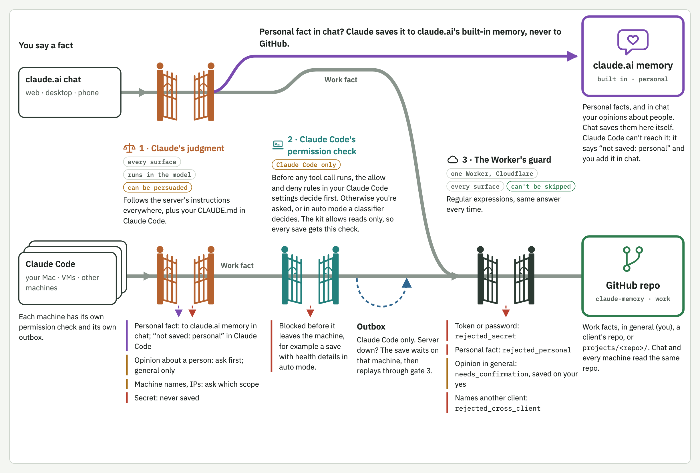

# claude-memory-cloud

One memory for Claude, everywhere you use it: claude.ai chat on web, Desktop and mobile, and Claude Code on every machine and VM. The memories are Markdown files in your own private GitHub repos, served by a small server you run on Cloudflare Workers.

Claude Code's built-in memory lives in files on one machine, and claude.ai chat has its own separate memory. Neither reaches the other or your other machines. This project keeps one set of work memories in GitHub and connects it to every Claude surface as a custom connector.

## Where a memory goes



Every save meets up to three checks:

1. **Claude's judgment**, on every surface. Claude follows the server's instructions, and in Claude Code your `CLAUDE.md`, to decide whether and where a fact belongs. It can be persuaded, so it's not the last word.
2. **Claude Code's permission check**, in Claude Code only. The setup kit allows the read tools, so every save is approved by you or, in auto mode, judged by Claude Code's classifier.
3. **The Worker's guard**, on every surface. Regular expressions on the server refuse secrets, personal facts and one client's details in another client's repo. It can't be skipped.

Personal facts (health, money, family, where you live, travel) belong in claude.ai's built-in memory, never in GitHub. In chat Claude puts them there itself; in Claude Code it answers "not saved: personal" so you can add them in chat.

There's also [a cartoon version](docs/images/memory-path-cartoon.png) of the same path.

## What you get

- **Three kinds of memory:** about you (`general`), about a client organization (in a repo inside the client's own GitHub org), and about one codebase (`project`, keyed by its git remote, so it's the same on every machine).
- **It's yours.** Plain Markdown in your repos. Every change is a commit; you can read, edit or delete anything by hand.
- **Narrow access.** The server acts as you through a GitHub App installed only on your memory repos, with one permission and no private key.
- **No lost writes.** Concurrent edits become conflict copies, not overwrites. In local Claude Code, saves made while the server is down queue in an outbox and replay later.
- **Memory text is treated as data, not instructions.** Claude is told never to act on what a memory says, and the server's own messages carry a marker memory text can't fake.

## Get started

- **Run your own server:** [Quickstart](docs/QUICKSTART.md). You need a GitHub account and a Cloudflare account on Workers Paid ($5/month).
- **Use a friend's server:** [Quickstart for friends](docs/QUICKSTART-FRIEND.md).
- **Questions:** [FAQ](docs/FAQ.md). **Why it's built this way:** [Design decisions](docs/DECISIONS.md). **Risks and mitigations:** [Threat model](docs/THREAT-MODEL.md). **Removing it:** [Uninstall](docs/UNINSTALL.md).

## Develop

```bash
npm ci
cp .dev.vars.example .dev.vars   # fill in the staging app and your SCOPES; never commit it
npm test                         # vitest in workerd (no network; GitHub is mocked)
npm run typecheck
npm run dev                      # local wrangler dev
npm run test:local               # tests for the local kit (Python 3.9+, stdlib only, temporary HOME)
```

`wrangler.jsonc` is a template. Your deployment's values (URL, GitHub App slug, storage IDs) go in a git-ignored `wrangler.local.jsonc`, which `npm run deploy:*` and `scripts/wrangler.sh` use automatically. See [Quickstart Part 5](docs/QUICKSTART.md#part-5--deploy-the-server).

```bash
npm run deploy:staging
npm run deploy:production
```

The local kit (`./setup.sh`) turns off Claude Code's auto-memory and installs the memory routing rule and hooks on each Mac, Linux machine or VM; `./setup.sh --uninstall` reverses it. See [Quickstart Part 7](docs/QUICKSTART.md#part-7--set-up-each-machine).

## License

[MIT](LICENSE)
